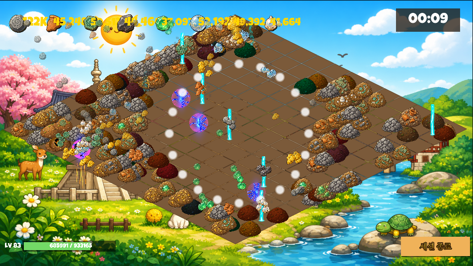
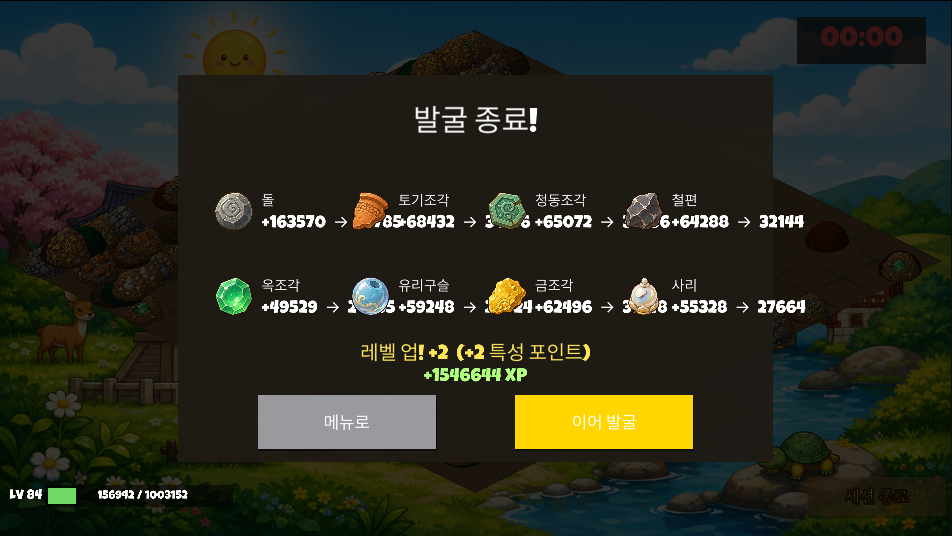
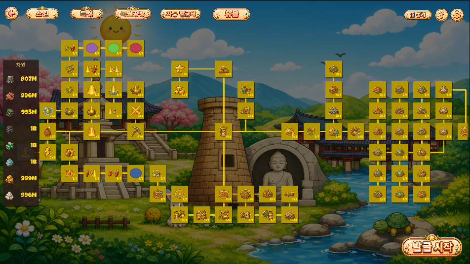
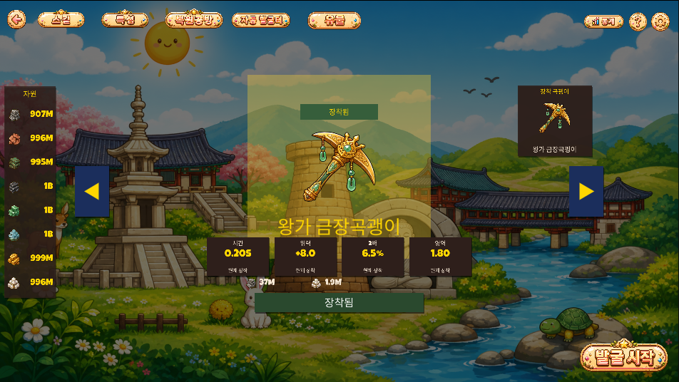
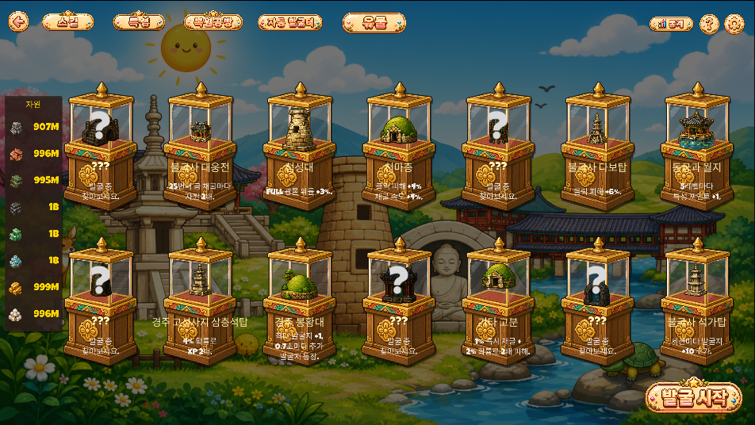
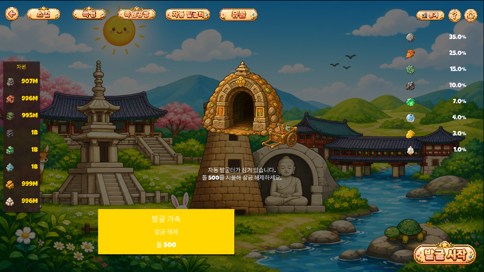
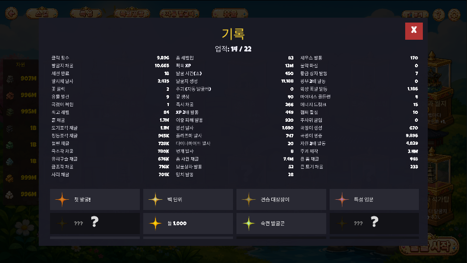

# 아토리아 발굴단

> 짧은 발굴 세션에서 원석을 캐고, 곡괭이/스킬트리/특성/유물/자동 발굴터로 성장 루프를 확장하는 Unity 모바일 2D 클리커/방치형 게임입니다.


## 목차

- [프로젝트 개요](#프로젝트-개요)
- [데모](#데모)
- [게임 루프](#게임-루프)
- [핵심 구현](#핵심-구현)
- [기술 상세](#기술-상세)
- [트러블슈팅](#트러블슈팅)
- [배운 점](#배운-점)
- [다른 구현 방법](#다른-구현-방법)
- [실행 방법](#실행-방법)
- [에셋 및 라이선스](#에셋-및-라이선스)

## 프로젝트 개요

아토리아 발굴단은 모바일에서 짧게 반복할 수 있는 발굴 세션을 중심으로 만든 2D 성장형 게임입니다. 플레이어는 제한 시간 동안 화면의 발굴 커서를 움직여 암석을 부수고, 세션이 끝나면 획득한 원석을 주괴로 정산합니다. 주괴는 곡괭이 제작, 스킬트리, 자동 발굴터 강화에 사용되며, 유물과 특성은 다음 세션의 플레이 감각을 바꿉니다.

이 프로젝트는 완성된 라이브 서비스라기보다, 클리커/방치형 게임에서 자주 쓰이는 **세션 보상**, **영구 성장**, **데이터 저장**, **확률형 보너스**, **UI 상태 동기화**를 Unity 클라이언트 안에서 직접 구현해 본 포트폴리오 프로젝트입니다.

| 구분 | 내용 |
| --- | --- |
| 장르 | 모바일 2D 클리커 / 방치형 / 성장형 채굴 게임 |
| 엔진 | Unity 6000.4.2f1 |
| 렌더링 | Universal Render Pipeline 17.4.0 |
| UI | Unity uGUI |
| 언어 | C# |
| 메인 씬 | `Assets/Scenes/Rebuild_Main.unity` |
| 공개 범위 | 상용 에셋, 원본 작업 파일, 내부 문서, 패키지성 산출물 제외 |

## 데모

### 플레이 영상

영상은 추후 추가 예정입니다.

예정 위치:

```text
docs/video/atoria-gameplay.mp4
```

GitHub에 영상을 추가할 때는 아래처럼 교체할 수 있습니다.

```md
https://github.com/user-attachments/assets/VIDEO_ID
```

### 스크린샷

README용 스크린샷은 `docs/screenshots`에 정리했습니다.

| 화면 | 설명 | 파일 |
| --- | --- | --- |
| 시작 화면 | 게임 진입, 저장 데이터 로드, 기본 메뉴 흐름 | `docs/screenshots/01_start.png` |
| 발굴 세션 | 커서 중심 범위 채굴, 암석 파괴, 원석 획득 | `docs/screenshots/02_mining-session.png` |
| 세션 결과 | 획득 원석 정산, 주괴 변환, 이어하기 흐름 | `docs/screenshots/03_session-result.png` |
| 스킬트리 | 영구 성장, 선행 노드, 가격/레벨 표시 | `docs/screenshots/04_skill-tree.png` |
| 대장간 | 곡괭이 제작, 장착, 홀드 입력 | `docs/screenshots/05_anvil.png` |
| 유물 도감 | 세션 중 발견한 유물과 효과 확인 | `docs/screenshots/06_artifacts.png` |
| 자동 발굴터 | 방치형 수익, 속도/재료 강화 | `docs/screenshots/07_the-mine.png` |
| 엔딩/도전 | 장기 목표와 진행도 확인 | `docs/screenshots/08_ending.png` |

<p align="center">
  
  
  
  
  
  
  
  
</p>

## 게임 루프

```text
시작 화면
  -> 발굴 세션 시작
  -> 커서를 움직여 암석을 범위 채굴
  -> 원석, 경험치, 유물, 특수 효과 획득
  -> 제한 시간 종료
  -> 세션 원석을 주괴로 정산
  -> 곡괭이 / 스킬트리 / 특성 / 자동 발굴터 강화
  -> 다음 세션에서 더 빠르고 넓게 채굴
```

기획적으로는 "한 번 더 하면 더 많이 캘 수 있을 것 같다"는 감각을 목표로 했습니다. 그래서 세션 중에는 즉각적인 파괴감과 원석 드롭을 보여주고, 세션이 끝난 뒤에는 정산 화면에서 성장 재화를 한 번에 확인하도록 구성했습니다.

## 핵심 구현

| 시스템 | 구현 파일 | 설명 포인트 |
| --- | --- | --- |
| 세션 진행 | `Assets/Scripts/Mining/MiningSessionController.cs` | 메뉴와 발굴 화면 전환, 타이머, 결과창, 다음 세션 초기화 |
| 타일/암석 생성 | `Assets/Scripts/Mining/TileGrid.cs`, `Assets/Scripts/Mining/RockSpawner.cs` | 세션마다 채굴판을 구성하고 확률에 따라 암석/광석/유물 후보 생성 |
| 범위 채굴 | `Assets/Scripts/Mining/MiningCursorUI.cs`, `Assets/Scripts/Mining/Rock.cs` | 커서 반경 안의 암석을 탐색하고 중앙에서 데미지 판정 처리 |
| 재화 흐름 | `Assets/Scripts/Mining/GoldAndOreMechanics.cs` | 세션 원광과 영구 주괴를 분리해 보상 정산감 강화 |
| 성장 시스템 | `Assets/Scripts/Mining/SkillTreeManager.cs`, `Assets/Scripts/Mining/LevelMechanics.cs` | 스킬트리, 레벨, 특성 포인트, 보너스 성장 |
| 곡괭이 제작 | `Assets/Scripts/Mining/AnvilManager.cs`, `Assets/Scripts/Mining/PickaxeDef.cs` | 14종 곡괭이 제작/장착, 홀드 제작, 저장 연동 |
| 유물 | `Assets/Scripts/Mining/ArtifactsManager.cs`, `Assets/Scripts/Mining/ArtifactId.cs` | 세션당 발견 제한, 확률 드롭, 도감/보너스 관리 |
| 투사체/연쇄 효과 | `Assets/Scripts/Mining/ProjectileLauncher.cs`, `Assets/Scripts/Mining/ProjectileFx.cs` | 확률 발동 효과, 풀링, 동시 개수 제한, 연쇄 폭주 방지 |
| 저장 | `Assets/Scripts/Saving/DataPersistenceManager.cs`, `Assets/Scripts/Saving/GameDataDTO.cs`, `Assets/Scripts/Saving/FileDataHandler.cs` | JSON 저장, DTO 스키마, 자동 저장, 백업 파일 복구 |
| 통계/업적 | `Assets/Scripts/Stats/StatsManager.cs`, `Assets/Scripts/Stats/AchievementsManager.cs` | 행동 카운트 누적, 업적 조건 체크, UI 팝업 이벤트 |
| 스프라이트 로딩 | `Assets/Scripts/Mining/SpriteLibrary.cs` | `Resources` 기반 캐시와 누락 시 런타임 폴백 |

## 기술 상세

### 1. 세션 기반 발굴 흐름

모바일 클리커/방치형 게임은 짧은 플레이 단위와 긴 성장 루프가 함께 있어야 반복 플레이가 자연스럽습니다. 이 프로젝트에서는 발굴을 하나의 세션으로 묶고, `MiningSessionController`가 시작, 제한 시간, 결과, 재시작을 관리합니다.

구현 방식:

- 발굴 시작 시 메뉴 UI를 숨기고 발굴용 캔버스를 활성화합니다.
- `TileGrid`와 `RockSpawner`가 세션용 타일과 암석을 다시 준비합니다.
- 세션 타이머가 끝나면 `SessionResultsUI`로 획득량을 보여줍니다.
- "계속 발굴"을 누르면 세션 상태, 보너스 카운터, 투사체 제한 등을 초기화하고 다시 시작합니다.

어려웠던 점:

- 세션이 반복되면서 이전 세션의 투사체 카운트, 유물 발견 상태, 임시 보너스가 남을 수 있었습니다.
- 해결을 위해 세션 진입 지점을 하나로 모으고, 시작 시 초기화해야 하는 상태를 컨트롤러에서 명확히 호출하도록 정리했습니다.

배운 점:

- 게임 클라이언트는 기능을 만드는 것만큼 "언제 초기화하고 언제 저장할지"가 중요합니다.
- 씬을 여러 개로 나누지 않아도, 캔버스와 컨트롤러를 잘 나누면 한 씬 안에서 세션 흐름을 관리할 수 있습니다.

대안:

- 화면마다 별도 씬을 두면 전환 구조는 명확하지만, 공통 매니저와 저장 데이터 전달이 복잡해질 수 있습니다.
- 세션 없이 무한 채굴로 만들면 구현은 단순하지만, 결과 화면을 통한 보상 정산감이 약해질 수 있습니다.

### 2. 커서 중심 범위 채굴

처음에는 암석을 각각 버튼처럼 누르는 방식도 생각할 수 있지만, 이 프로젝트는 모바일에서 손가락을 움직이며 넓은 범위를 긁는 감각을 목표로 했습니다. 그래서 입력을 암석마다 나누지 않고 `MiningCursorUI`가 현재 커서 반경 안의 암석을 찾은 뒤 `Rock.ApplyExternalHit()`을 호출합니다.

구현 방식:

- 커서 위치와 반경을 UI 좌표 기준으로 계산합니다.
- 살아 있는 암석 목록을 순회하면서 반경 안에 들어온 암석만 데미지를 줍니다.
- 곡괭이, 스킬트리, 특성, 유물 효과가 커서 반경과 타격 주기에 영향을 줍니다.
- `Rock`은 데미지를 받은 뒤 체력, 파괴, 드롭, 투사체 발동, 유물 표시를 처리합니다.

어려웠던 점:

- 암석 자체가 입력을 받으면 UI 오버레이, 버튼, 커서 입력이 서로 충돌할 수 있었습니다.
- 제작 오버레이처럼 화면 위에 올라오는 이미지가 `raycastTarget`을 가진 경우, 포인터 업/취소 이벤트가 막히는 문제가 있었습니다.

해결:

- 핵심 채굴 판정은 커서 쪽에서 중앙집중식으로 처리했습니다.
- 입력을 막으면 안 되는 장식 이미지는 레이캐스트 대상에서 제외했습니다.

배운 점:

- 모바일 UI 게임에서는 "보이는 UI"와 "입력을 받아야 하는 UI"를 분리해서 생각해야 합니다.
- 판정 주체를 한 곳에 모으면 밸런스 조정과 디버깅이 쉬워집니다.

대안:

- `Collider2D`와 `Physics2D.OverlapCircle`을 쓰면 물리 기반 판정으로 확장하기 쉽습니다.
- 각 암석을 버튼으로 만들면 구현은 직관적이지만, 많은 오브젝트가 있을 때 입력 충돌과 관리 비용이 커질 수 있습니다.

### 3. 원광과 주괴를 분리한 보상 경제

세션 중 바로 영구 재화를 늘리는 대신, 세션 동안 얻은 원석은 임시 보상으로 쌓고 결과 화면에서 주괴로 변환합니다.

구현 방식:

- `GoldAndOreMechanics`가 세션 원광과 영구 주괴를 분리해서 관리합니다.
- 발굴 중에는 `AddSessionOre` 계열 흐름으로 원광을 누적합니다.
- 세션 종료 시 `CraftSessionToBars()`로 원광을 주괴로 변환합니다.
- 자동 발굴터처럼 세션 밖 수익은 `AddBarsDirect()`로 바로 영구 재화에 반영합니다.

기획 의도:

- 세션 중에는 "얼마나 캤는지"에 집중하게 만들고, 끝난 뒤에 보상 정산의 만족감을 줍니다.
- 재화를 두 단계로 나누면 결과창, 보너스 배율, 유물 효과를 설명하기 쉽습니다.

배운 점:

- 재화가 하나뿐이면 구현은 빠르지만, 보상 연출과 성장 체감이 약해질 수 있습니다.
- 클라이언트에서는 같은 숫자라도 "세션 중 임시 값"인지 "저장되는 영구 값"인지 명확히 나눠야 버그가 줄어듭니다.

대안:

- 모든 획득을 즉시 영구 재화로 저장하면 구조는 단순합니다.
- 서버 기반 게임이라면 세션 결과만 서버에 검증 요청하고, 클라이언트는 연출과 임시 표시만 담당하는 방식도 가능합니다.

### 4. 스킬트리, 특성, 유물, 곡괭이 성장

성장 요소는 플레이어가 다음 세션을 다시 시작할 이유를 만드는 장치입니다. 이 프로젝트에서는 스킬트리, 레벨 특성, 유물, 곡괭이를 서로 다른 성장 축으로 나눴습니다.

구현 방식:

- `UpgradeId`와 `SkillTreeManager`가 스킬 노드 레벨, 가격, 선행 조건, 구매 이벤트를 관리합니다.
- `LevelMechanics`가 경험치와 레벨업, 특성 포인트를 관리합니다.
- `ArtifactsManager`는 세션 중 유물 등장 확률과 발견 여부를 관리합니다.
- `PickaxeDef`와 `AnvilManager`는 곡괭이 제작 비용, 제작 상태, 장착 상태를 관리합니다.

어려웠던 점:

- 성장 종류가 늘어나면서 UI가 매번 직접 값을 읽으면 갱신 타이밍이 꼬일 수 있었습니다.
- 제작 버튼은 단순 클릭이 아니라 2.4초 홀드 입력이 필요해, 버튼 이벤트만으로는 취소/종료 처리가 부족했습니다.

해결:

- 상태 변경 후 이벤트로 UI가 갱신되도록 구성했습니다.
- `PointerHoldForwarder`를 통해 버튼 홀드 입력을 명확히 전달하고, 홀드 중 취소/완료를 분리했습니다.

배운 점:

- 성장 시스템은 데이터, 저장, UI, 입력이 모두 연결되므로 작은 기능처럼 보여도 결합도가 높습니다.
- 초반에는 코드 테이블이 빠르지만, 항목이 많아질수록 ScriptableObject나 외부 표로 옮길 필요가 생깁니다.

대안:

- ScriptableObject로 곡괭이/유물/스킬 데이터를 분리하면 디자이너가 Unity Inspector에서 조정하기 쉽습니다.
- CSV나 Google Sheets를 빌드 파이프라인에 연결하면 밸런스 조정 이력을 관리하기 좋습니다.

### 5. 투사체와 연쇄 효과 제어

스킬트리 보너스로 빔, 플라즈마, 다이너마이트, 번개 같은 특수 효과가 발동합니다. 이런 효과는 재미를 주지만, 제한 없이 연쇄되면 화면과 성능이 쉽게 무너질 수 있습니다.

구현 방식:

- `ProjectileLauncher`가 효과 타입별 발동 확률과 생성 위치를 관리합니다.
- 타입별 동시 생성 수 제한을 둡니다.
- 전체 투사체 풀의 최대 크기를 제한합니다.
- 연쇄 생성 깊이를 제한해 무한 발동을 막습니다.

어려웠던 점:

- 확률 효과가 여러 성장 시스템과 겹치면 한 번의 타격에서 예상보다 많은 오브젝트가 생길 수 있습니다.
- 시각적으로는 화려해야 하지만 모바일에서는 프레임 저하를 막아야 합니다.

배운 점:

- 확률형 전투/채굴 효과는 재미보다 먼저 상한선을 설계해야 합니다.
- "잘 터질 때"뿐 아니라 "너무 잘 터질 때"의 방어 코드가 필요합니다.

대안:

- 모든 효과를 실제 오브젝트로 만들지 않고, 일부는 shader/VFX/파티클만으로 처리할 수 있습니다.
- 더 큰 프로젝트라면 Addressables와 풀 매니저를 분리해 이펙트 로딩과 수명 관리를 전담시킬 수 있습니다.

### 6. 저장과 복구

모바일 게임은 앱이 언제든 중단될 수 있기 때문에 저장 타이밍이 중요합니다. 이 프로젝트는 `IDataPersistence` 인터페이스를 구현한 매니저들이 각자의 데이터를 저장/로드하고, `DataPersistenceManager`가 전체 저장 흐름을 모읍니다.

구현 방식:

- `GameDataDTO`에 저장 스키마를 모읍니다.
- 게임 시작 시 저장 파일을 읽고 각 매니저에 데이터를 전달합니다.
- 일정 주기로 자동 저장합니다.
- 앱 일시정지/종료 시 저장을 시도합니다.
- `FileDataHandler`는 백업 파일을 사용해 저장 파일 손상 시 복구 가능성을 둡니다.

어려웠던 점:

- 스킬, 유물, 곡괭이처럼 배열 기반 데이터가 늘어나면 기존 저장 데이터와 길이가 달라질 수 있습니다.
- 매니저 로드 순서에 따라 UI가 아직 준비되지 않았는데 값 갱신이 들어올 수 있습니다.

배운 점:

- 저장 데이터는 "현재 코드에서 쓰는 구조"가 아니라 "나중에도 유지해야 하는 계약"에 가깝습니다.
- 새 항목이 추가될 때 기본값을 안전하게 채우는 마이그레이션 관점이 필요합니다.

대안:

- 로컬 JSON은 구현과 디버깅이 쉽지만, 조작 방지가 필요한 서비스에서는 서버 저장이나 암호화/검증이 필요합니다.
- 큰 프로젝트에서는 저장 스키마 버전별 마이그레이션 클래스를 분리할 수 있습니다.

## 기획 및 클라이언트 관점

| 관점 | 고민 | 구현에서 반영한 점 |
| --- | --- | --- |
| 짧은 플레이 | 모바일에서 오래 붙잡지 않아도 성장이 느껴져야 함 | 제한 시간 세션과 결과창 정산 |
| 성장 체감 | 같은 행동이 반복되면 지루해질 수 있음 | 곡괭이, 커서 범위, 투사체, 유물로 채굴 감각 변화 |
| 목표 제공 | 다음에 무엇을 해야 할지 보여줘야 함 | 스킬트리, 대장간, 자동 발굴터, 업적/엔딩 |
| 보상 연출 | 숫자가 오른다는 사실을 명확히 보여줘야 함 | 원석 팝업, 결과 UI, 주괴 변환 |
| 모바일 안정성 | 앱 전환과 종료가 잦음 | 자동 저장, pause/quit 저장, 백업 파일 |
| 확장성 | 콘텐츠가 늘면 코드 수정량이 커짐 | ID/정의 테이블, 매니저 분리, 이벤트 기반 UI |

## 주요 튜닝 값

| 값 | 현재 의도 | 너무 작을 때 | 너무 클 때 |
| --- | --- | --- | --- |
| 세션 시간 | 짧게 반복 가능한 발굴 단위 | 보상 확인 전 끝나 답답함 | 한 판이 길어져 모바일 템포가 느려짐 |
| 커서 기본 반경 | 손가락으로 긁는 채굴 감각 | 암석을 맞히기 어려움 | 조작 없이 자동으로 다 캐는 느낌 |
| 곡괭이 제작 홀드 시간 | 제작 선택을 신중하게 만드는 장치 | 실수 제작이 많아짐 | 제작 UI가 답답하게 느껴짐 |
| 자동 저장 주기 | 모바일 중단 상황 대비 | 데이터 손실 위험 | 너무 잦은 디스크 접근 |
| 투사체 동시 생성 제한 | 화려함과 성능 사이의 안전장치 | 성장 보상이 약해 보임 | 화면 혼잡, 프레임 저하 |
| 유물 세션 제한 | 희귀 보상의 가치 유지 | 유물이 너무 안 나와 목표가 약함 | 한 세션 보상이 과하게 커짐 |

## 트러블슈팅

| 문제 | 원인 | 해결 | 배운 점 |
| --- | --- | --- | --- |
| 세션 재시작 후 이전 효과가 남음 | 투사체/임시 보너스/발견 상태가 세션 밖으로 누수 | 세션 시작 지점에서 관련 상태를 명시적으로 초기화 | 반복 플레이 게임은 reset boundary가 중요 |
| 제작 홀드가 중간에 끊기거나 취소되지 않음 | 버튼 클릭 이벤트만으로는 pointer up/exit 흐름을 충분히 다루기 어려움 | 홀드 전달용 컴포넌트로 입력 단계를 분리 | 모바일 UI 입력은 클릭보다 생명주기가 길다 |
| 오버레이 이미지가 입력을 막음 | 장식용 UI가 `raycastTarget`으로 포인터 이벤트를 가로챔 | 입력이 필요 없는 이미지는 레이캐스트 대상에서 제외 | UI는 보이는 순서와 입력 우선순위가 다르다 |
| 런타임 생성 스프라이트가 깨져 보일 수 있음 | 절차적으로 만든 링/게이지 이미지가 도메인 리로드 뒤 재연결 필요 | `OnEnable`에서 다시 바인딩하고 폴백 스프라이트 제공 | 에디터와 런타임 생명주기를 따로 확인해야 한다 |
| 저장 데이터 배열 길이가 코드와 달라짐 | 스킬/곡괭이/유물 항목 추가로 기존 저장 파일 구조가 변함 | DTO 버전과 기본값 보정 흐름을 둠 | 저장 데이터는 기능보다 오래 살아남는다 |
| 확률 효과가 한 번에 너무 많이 발생 | 성장 보너스가 겹치면서 투사체가 폭증 | 타입별 동시 수, 전체 풀, 연쇄 깊이 제한 | 랜덤 효과에는 항상 상한선이 필요하다 |
| 리소스 누락 시 UI가 비어 보임 | `Resources` 경로의 이미지가 없거나 이름이 다름 | `SpriteLibrary` 캐시와 런타임 폴백 사용 | 포트폴리오라도 실패 화면을 비워두지 않는 편이 좋다 |

## 배운 점

- 클라이언트 개발은 화면을 만드는 일뿐 아니라, 상태가 언제 생성되고 언제 사라지는지 정리하는 일입니다.
- 클리커/방치형 장르는 단순해 보여도 재화, 성장, 저장, UI 갱신이 강하게 연결됩니다.
- 보상 시스템은 수치보다 흐름이 중요합니다. 세션 중 원광을 모으고, 종료 후 주괴로 바꾸는 구조가 결과 화면의 의미를 만들어 줬습니다.
- 확률 보너스는 재미를 주지만, 제한이 없으면 성능과 밸런스를 동시에 망칠 수 있습니다.
- 처음에는 코드 테이블로 빠르게 구현했지만, 항목이 늘어나면 ScriptableObject나 외부 데이터 테이블로 옮기는 편이 유지보수에 좋습니다.
- 초보 단계에서 만든 프로젝트일수록 "왜 이렇게 만들었는지", "어떤 문제가 있었는지", "다음에는 어떻게 바꿀지"를 설명할 수 있어야 포트폴리오 가치가 커집니다.

## 다른 구현 방법

| 현재 방식 | 다른 방법 | 장단점 |
| --- | --- | --- |
| 한 씬에서 캔버스 전환 | 메뉴/발굴/결과를 별도 씬으로 분리 | 구조는 명확하지만 공통 상태 전달이 복잡 |
| UI 좌표 기반 범위 채굴 | `Collider2D` + `Physics2D.OverlapCircle` | 물리 확장에 좋지만 UI 기반 게임에서는 좌표 변환 관리 필요 |
| 코드 기반 정의 테이블 | ScriptableObject | Unity Inspector에서 수정하기 쉽고 디자이너 협업에 유리 |
| `Resources.Load` 캐시 | Addressables | 대형 프로젝트와 원격 리소스에 유리하지만 초기 설정 비용 증가 |
| 로컬 JSON 저장 | 서버 저장/검증 | 서비스 안정성은 높지만 백엔드와 인증 구조 필요 |
| 실제 투사체 오브젝트 | shader/VFX 중심 연출 | 성능 관리에 유리하지만 충돌/연쇄 로직 표현은 별도 설계 필요 |

## 프로젝트 구조

```text
Assets/
  Scenes/
    Rebuild_Main.unity
  Scripts/
    Audio/        사운드 매니저와 중복 재생 제어
    Core/         카메라 비율 등 공통 런타임 보조
    Mining/       발굴, 성장, 유물, 곡괭이, 자동 발굴터, UI 대부분
    Saving/       저장 DTO, 파일 핸들러, persistence 인터페이스
    Stats/        통계와 업적
    Tutorial/     튜토리얼 흐름
    UI/           메뉴, 설정, 포인터, 공통 UI
    Util/         숫자 포맷 등 유틸리티
  Resources/
    Sprites/      프로젝트 소유 AI 생성 이미지 기반 스프라이트
Packages/
  manifest.json
ProjectSettings/
  ProjectVersion.txt
THIRD_PARTY_NOTICES.txt
```

## 실행 방법

1. Unity Hub에서 이 폴더를 프로젝트로 추가합니다.
2. Unity `6000.4.2f1`로 엽니다.
3. `Assets/Scenes/Rebuild_Main.unity` 씬을 엽니다.
4. Play 버튼을 눌러 실행합니다.

권장 확인 순서:

1. 시작 화면에서 새 게임 또는 이어하기 흐름을 확인합니다.
2. 발굴 세션에서 커서를 움직여 암석이 범위로 파괴되는지 확인합니다.
3. 세션 종료 후 원석이 주괴로 정산되는지 확인합니다.
4. 스킬트리, 대장간, 유물, 자동 발굴터 화면에서 저장/갱신이 유지되는지 확인합니다.

## 에셋 및 라이선스

공개용 소스에는 상용 에셋 팩, 외부 오디오, 원본 작업 파일, 내부 문서, 불필요한 패키지 산출물을 포함하지 않았습니다.

이미지 리소스:

- `Assets/Resources/Sprites/` 아래 PNG 이미지는 프로젝트 오너가 이 프로젝트를 위해 직접 AI로 생성한 이미지를 기반으로 사용했습니다.

폰트:

- `Assets/Fonts/LuckiestGuy.ttf`
  - Font: Luckiest Guy Regular
  - Copyright: Copyright (c) 2010 Brian J. Bonislawsky DBA Astigmatic (AOETI)
  - License: Apache License 2.0
  - Source/license: https://github.com/google/fonts/tree/main/apache/luckiestguy
- `Assets/Fonts/Pretendard-Regular.ttf`
  - Font: Pretendard Regular
  - License: SIL Open Font License 1.1
  - Source/license: https://github.com/orioncactus/pretendard/blob/main/LICENSE

자세한 고지는 `THIRD_PARTY_NOTICES.txt`에 정리했습니다.

## 현재 한계와 다음 개선

- 실제 플레이 영상과 스크린샷은 아직 README에 삽입하지 않았습니다.
- 밸런스 값이 코드에 남아 있는 부분이 있어, 장기적으로는 ScriptableObject나 CSV 기반 데이터로 옮기는 편이 좋습니다.
- 모바일 실기기에서 프레임, 터치감, 해상도 대응을 추가로 검증할 필요가 있습니다.
- 로컬 저장은 포트폴리오와 싱글 플레이에는 충분하지만, 서비스형 게임이라면 서버 저장/검증 구조가 필요합니다.
- 튜토리얼과 초반 동선은 더 짧고 명확하게 다듬을 여지가 있습니다.

## 면접에서 설명할 수 있는 포인트

- "왜 세션 기반으로 만들었나요?"
  - 짧은 플레이와 결과 보상 화면을 분리해 모바일 반복 플레이에 맞추기 위해서입니다.
- "채굴 판정은 어떻게 했나요?"
  - 각 암석이 입력을 받는 구조가 아니라, 커서 UI가 중심에서 반경 안의 암석을 찾아 데미지를 주는 구조입니다.
- "저장 구조는 어떻게 잡았나요?"
  - 각 매니저가 `IDataPersistence`를 구현하고, 중앙 저장 매니저가 DTO로 모아 JSON 파일에 저장합니다.
- "가장 어려웠던 점은 무엇인가요?"
  - 기능 자체보다 세션 반복 시 상태가 남지 않게 만드는 것, UI 입력이 서로 막지 않게 하는 것, 확률 효과가 과하게 폭증하지 않게 제한하는 것이 어려웠습니다.
- "다시 만든다면 무엇을 바꾸겠나요?"
  - 스킬, 유물, 곡괭이 데이터를 ScriptableObject나 외부 테이블로 분리하고, 모바일 실기기 프로파일링을 먼저 붙여 밸런스와 성능을 같이 보겠습니다.
