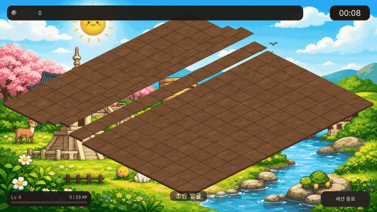
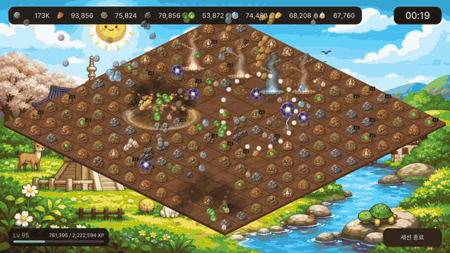
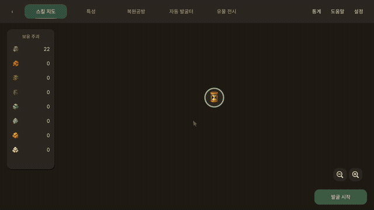

# 아토리아 발굴단

아토리아 발굴단은 짧은 발굴을 반복하면서 곡괭이, 스킬, 특성, 유물, 자동 발굴터를 강화하는 Unity 2D 성장형 게임입니다. 커서를 움직여 발굴지를 캐고, 세션이 끝나면 원석을 주괴로 정산합니다. 주괴로 성장 경로를 선택하고 다음 발굴을 시작할 수 있습니다.

## 플레이 미리보기

65초 플레이 트레일러에서 발굴 초반과 후반, 스킬 지도가 성장하는 장면을 발췌했습니다.

| 초반 발굴 | 후반 발굴 |
| --- | --- |
|  |  |

**스킬 지도.** 첫 스킬을 구매해 인접 노드를 열고, 성장 후 지도를 축소해 전체 구조를 보여줍니다.

## 플레이

1. 시작 화면에서 **시작**, 스킬 지도에서 **발굴 시작**을 누릅니다.
2. Windows에서는 발굴지 위로 마우스를 움직입니다. 곡괭이는 범위 안에 들어온 발굴지를 주기적으로 타격합니다.
3. 정산에서 주괴를 받은 뒤 스킬 지도나 복원공방으로 이동합니다. 스킬 지도는 드래그로 이동하고 휠이나 우하단 돋보기로 확대하거나 축소할 수 있습니다.

## 구현

- **발굴과 정산**. 기본 발굴지는 빈칸에 배치됩니다. 추가 생성이 발동하면 같은 칸에 `×2`를 표시하고, 첫 번째 바위를 캔 뒤 두 번째 바위가 나타납니다. 세션에서 얻은 원석과 정산 후의 주괴를 따로 관리합니다.
- **성장 지도**. 첫 스킬을 구매하면 인접한 노드가 보입니다. 선행 스킬과 비용은 구매할 때 검증하며, 완성된 지도에는 77개 노드가 있습니다.
- **유물과 자동 발굴터**. 발굴 중에 발견한 유물은 3D 전시에 등록되며, 유물의 효과는 다음 세션에도 적용됩니다. 자동 발굴터는 주기마다 주괴를 지급합니다.
- **발굴 효과**. 번개와 플라즈마는 타격된 발굴지 사이를 연결합니다. 발사체와 효과 오브젝트는 재사용하고, 발사체가 타격할 후보는 그리드에서 조회합니다.
- **저장**. 진행 상황을 JSON으로 저장합니다. 읽기에 실패하면 백업 세이브를 확인합니다.

| 살펴볼 구현 | 경로 |
| --- | --- |
| 세션과 발굴지 배치 | [`MiningSessionController`](Assets/Scripts/Mining/MiningSessionController.cs), [`RockSpawner`](Assets/Scripts/Mining/RockSpawner.cs) |
| 성장 지도 | [`SkillTreeManager`](Assets/Scripts/Mining/SkillTreeManager.cs), [`SkillTreeDragController`](Assets/Scripts/UI/SkillTreeDragController.cs) |
| 타격 탐색과 연출 | [`RockQuery`](Assets/Scripts/Mining/RockQuery.cs), [`ProjectileFx`](Assets/Scripts/Mining/ProjectileFx.cs) |
| 유물 전시 | [`ArtifactMuseum3DGallery`](Assets/Scripts/UI/ArtifactMuseum3DGallery.cs) |
| 저장과 백업 | [`FileDataHandler`](Assets/Scripts/Saving/FileDataHandler.cs) |

## 실행

Windows 빌드를 받은 경우, ZIP의 모든 파일을 한 폴더에 풀고 `Atoria.exe`를 실행합니다.

Unity Hub에서 **Unity 6000.4.2f1**로 프로젝트 폴더를 엽니다. 첫 실행 때 Package Manager에서 uGUI와 glTFast 등 Unity 패키지를 받습니다. `Assets/Scenes/Rebuild_Main.unity`를 열고 **Play**를 누르면 됩니다. 메인 씬은 Built-in Render Pipeline과 uGUI를 사용합니다.

Windows용 IL2CPP 플레이어를 빌드하려면 Unity Hub에서 **Windows Build Support (IL2CPP)**를 설치하고, Build Profiles에서 Windows 플랫폼의 `Rebuild_Main` 씬을 선택합니다.

## 출처와 라이선스

짧은 발굴 세션과 반복 성장 구조는 EagleEye Games의 [Keep on Mining!](https://store.steampowered.com/app/3769130/Keep_on_Mining/)에서 영감을 받았습니다.

프로젝트 코드는 [MIT 라이선스](LICENSE)를 따릅니다. 게임에서 사용하는 프로젝트 제작 이미지와 모델을 포함하며, 일부 이미지에는 생성형 도구를 사용했습니다. 공개 버전의 튜토리얼과 구매 연출은 Unity 기본 UI와 TextMesh Pro로 동작합니다. 상용 패키지와 배포 권리를 확인하지 못한 오디오는 공개 소스에서 제외했습니다. 폰트 라이선스와 출처는 [제3자 고지](THIRD_PARTY_NOTICES.txt)에서 확인할 수 있습니다.
